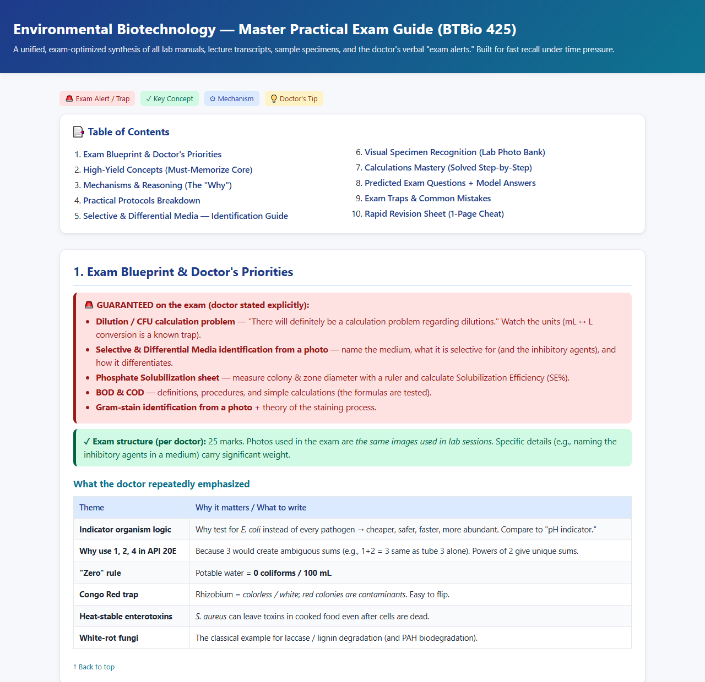
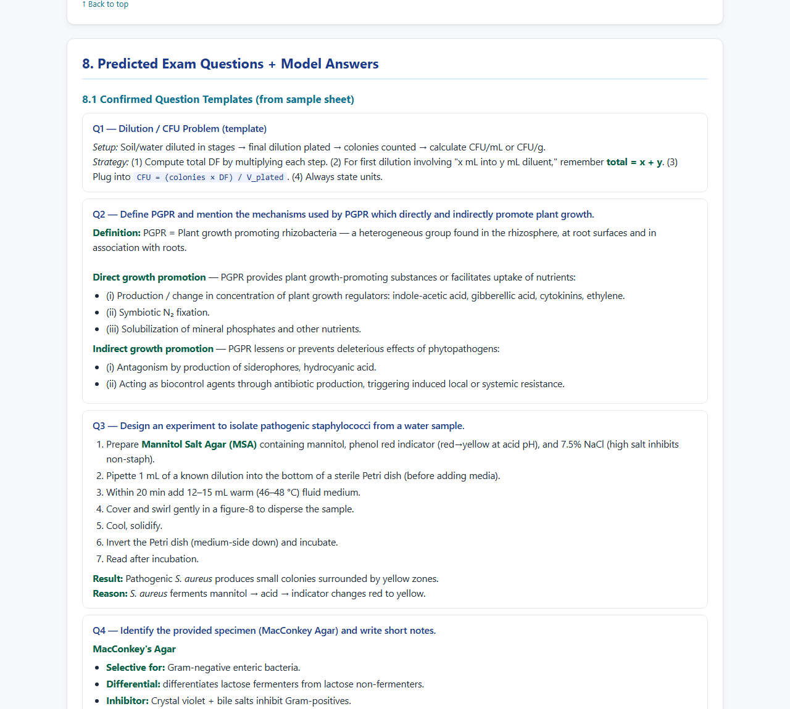
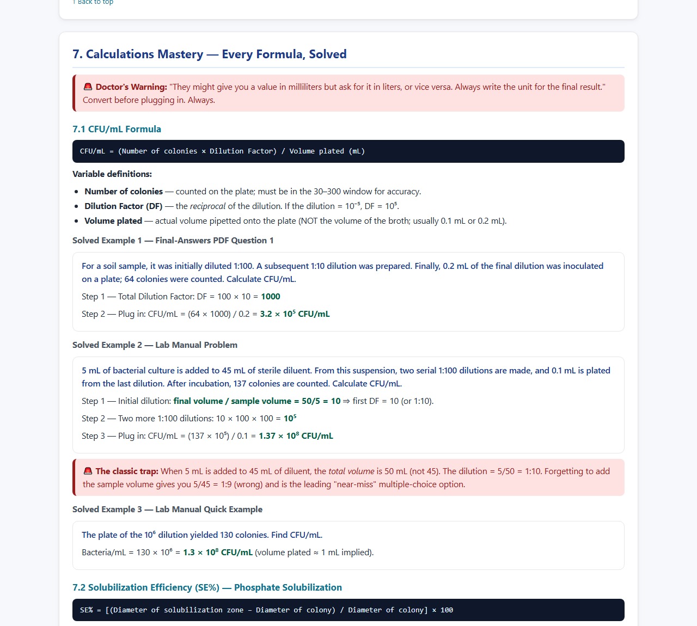
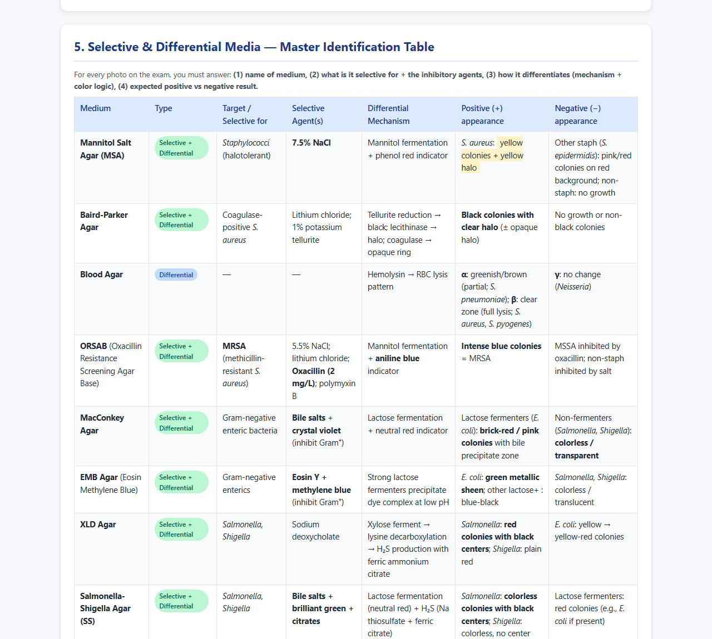
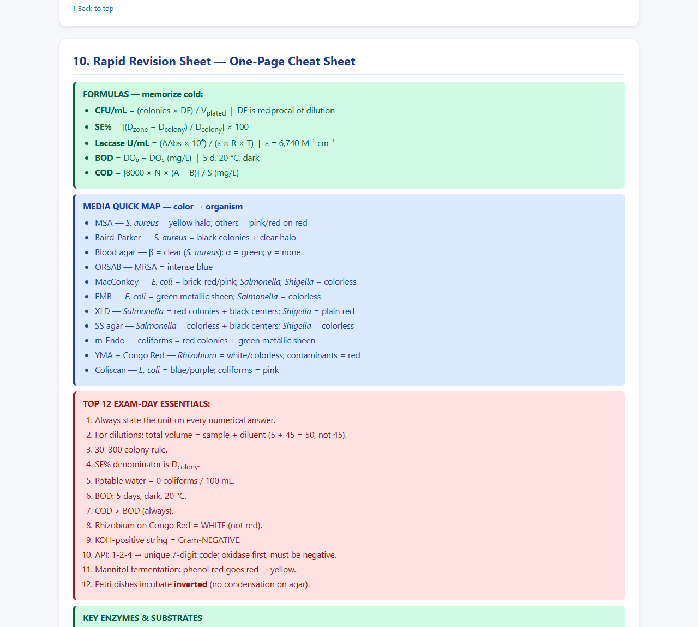

# Exam Study Guide & Predictor — a Claude Skill

**Predict the paper → build the study guide → learn how to answer it → (optionally) drill it until exam day.**

[](https://samdozer.github.io/exam-study-guide-predictor/examples/environmental-biotechnology/)
[](dist/exam-study-guide-predictor.skill)
[](LICENSE)


> **Free AI exam predictor and study-guide generator for students.** Give it your lecture slides, past papers and the doctor's notes. It tells you what the exam will most likely ask, how to answer it for full marks, and builds the study guide, all from *your* course material, not the internet.

<p align="center">
  <a href="https://samdozer.github.io/exam-study-guide-predictor/examples/environmental-biotechnology/">
    
  </a>
  <br><em>A real guide made by the skill for an Environmental Biotechnology practical exam. <a href="https://samdozer.github.io/exam-study-guide-predictor/examples/environmental-biotechnology/">Open the full example →</a></em>
</p>

## See it in action

| Predicted questions with model answers | Calculations solved step by step |
|---|---|
| [](https://samdozer.github.io/exam-study-guide-predictor/examples/environmental-biotechnology/#section-8) | [](https://samdozer.github.io/exam-study-guide-predictor/examples/environmental-biotechnology/#section-7) |
| **Identification table for lab photos** | **One-page rapid revision sheet** |
| [](https://samdozer.github.io/exam-study-guide-predictor/examples/environmental-biotechnology/#section-5) | [](https://samdozer.github.io/exam-study-guide-predictor/examples/environmental-biotechnology/#section-10) |

The example was made from the course's lab manuals, lecture transcripts and specimen photos, with an early version of the skill. The current version adds confidence tags on every prediction, the "how to answer" layer, per-doctor analysis and the formatting scan described below. The full HTML is in [`docs/examples/`](docs/examples/environmental-biotechnology/index.html).

A [Claude Skill](https://docs.claude.com/en/docs/agents-and-tools/agent-skills/overview) that turns *your own* course material — the doctor's booklet, lecture slides, professor transcripts (English or Arabic), past papers (even phone photos), model answers, lab manuals, notes — into:

1. a **study guide** organized for fast recall,
2. an **evidence-ranked prediction** of what the exam will actually ask,
3. an **exam operating manual**: how to recognize each question type, what to write for full marks, the traps, and how to check yourself,
4. **optional retention** — Anki flashcards or coached spaced repetition with the bundled **Enhanced Learn FASTER** kit. Always offered, never done without your yes.

Built for **biology-family courses** and **Egyptian university midterms and finals**, but every section is conditional, so it adapts to the material you give it.

> This repository replaces the former **ExamForge** project: its solving layer and Learn FASTER kit were merged in here, and its outdated prediction method was dropped in favour of the improved one below.

## Key features

- **Purple vs red.** What the professor *said* is on the exam (a fact: quoted, Arabic translated, dated, sourced) is kept visually and logically separate from what the skill *predicts* (an inference, confidence-tagged). Second-hand claims ("my friend said the Dr said…") are shown as *reported*, weaker than recorded ones, and a later statement overrides an earlier one ("coming" → "dropped").
- **Evidence-weighted prediction.** Past papers (recency-weighted, with recurrence and rotation) → model answers and the doctor's booklet → slide repetition and formatting → verbal emphasis → your insider tips → textbook last. A relevance rubric lets topics reach HIGH even with no past papers, and every prediction names its signals.
- **Reads Arabic — even messy Arabic.** Catches spoken cues like *"ده مهم للامتحان"*, *"حطوا عليها نجمة"*, *"دي جت السنة اللي فاتت"*, scope cues like *"محذوف / برا المنهج"*, Franco-Arabic group messages (*"da mohem lel emte7an"*), and repairs garbled speech-to-text transcripts.
- **Marks-driven.** Total marks and their split drive how many questions are predicted (a coverage budget of about 1.5–2× the real marks), how deep each answer goes (about one point per mark), and how your revision time is divided.
- **Reads slide formatting.** `scripts/extract_emphasis.py` finds text the professor made **bold**, underlined, red or another colour, or highlighted, in PDFs and PowerPoints — and keeps your own highlights from being mistaken for the professor's.
- **Built for Egyptian exams.** Per-doctor analysis when a course is split between doctors; an exam-scope ledger so nothing dropped gets predicted; past papers transcribed from photos into a year-by-year ledger; questions written with the real stems (Give reasons, Write short notes, Compare, ✓/✗ with correction…).
- **Executable.** IF I SEE THIS → IT MEANS THIS → I SHOULD DO THIS recognition tables, solving procedures, answer templates with MUST / GOOD / UNNECESSARY parts, a distractor bank, stuck-recovery, a time budget and an exam-room plan.
- **Conditional sections.** Calculations, visual/spot-ID tables, and protocol breakdowns activate only when the material contains them, and a "Checked and Skipped" list shows what was left out and why.
- **Source-faithful.** Bound to your materials, with a source tag on every claim (`L3 s12`, `Booklet p45`, `Final 2023 Q2`). The professor's terms and methods are preserved; outside knowledge only for central-but-poorly-explained points, always flagged; conflicts between sources are shown, not hidden.

## How it works

1. **Intake interview.** Course, exam type and format, total marks and their split, which doctor teaches what, the exam scope (cutoff, dropped, read-only), your sources, whether you highlighted your own PDFs, days left and your current level, the deliverable, depth, output format, image questions, and whether you want flashcards or coached review (default: no).
2. **Scope and doctors.** A scope ledger (nothing dropped is ever predicted) and every source tagged with its doctor.
3. **Past-paper ledger.** Every past paper, including phone photos, is transcribed into one table: year, midterm/final, doctor, question, stem, marks, topic, exact wording. Unreadable parts are marked `[illegible]`, never guessed.
4. **Purple pass.** The professor's explicit exam statements from transcripts, notes and group messages, captured verbatim with translation, source, date, and whether they were recorded or reported.
5. **Formatting pass.** `extract_emphasis.py` lists every bold, underlined, coloured or highlighted phrase in the slides and booklet.
6. **Prediction.** Signals are weighted and topics scored with the relevance rubric. Questions are predicted per doctor within a marks-based coverage budget, in the doctor's own stems, with model answers at one point per mark.
7. **Solving layer.** For each question type: how to recognise it, what to do, what to write, the trap, and how to check.
8. **Deliverable and self-check.** A colour-coded HTML or Word guide with only the sections the material justifies, then a coverage and faithfulness audit before delivery.
9. **Optional retention.** Only if you said yes: Anki cards, or a hand-off to the Enhanced Learn FASTER kit.

## What's improved

Everything added since the original skill (July 2026), by area:

**Reading the professor's material**
- **Slide formatting** ([#1](https://github.com/SamDozer/exam-study-guide-predictor/pull/1)): a script finds bold, underlined, red/other-colour and highlighted text in PDFs and PowerPoints. It compares against each file's own normal text and ignores titles, repeated headers and footers, grey template text and hyperlinks. Phrases emphasized more than once are ranked first, and pages with no text layer are rendered for checking by eye.
- **Your own highlights aren't the professor's** ([#2](https://github.com/SamDozer/exam-study-guide-predictor/pull/2)): highlight and underline marks drawn on top of a PDF are tagged separately, and `--ignore-annotations` drops them.
- **The doctor's booklet** (المذكرة / كتاب الدكتور) ([#2](https://github.com/SamDozer/exam-study-guide-predictor/pull/2)) is a top-tier source; its wording and numbering beat the slides'.
- **Past papers from photos** ([#2](https://github.com/SamDozer/exam-study-guide-predictor/pull/2)), transcribed into a year-by-year ledger, with duplicates merged and illegible parts flagged.
- **Messier Arabic** ([#3](https://github.com/SamDozer/exam-study-guide-predictor/pull/3)): more Egyptian cues (*حطوا عليها نجمة*, *دي جت السنة اللي فاتت*, *خلي بالك من الرسمة*), Franco-Arabic group messages, repair of garbled speech-to-text transcripts, and repetition or dictation ("اكتبوا ورايا") treated as emphasis, with timestamps kept.

**Predicting the exam**
- **Works without past papers** ([#1](https://github.com/SamDozer/exam-study-guide-predictor/pull/1)): a relevance rubric scores each concept on testability, formatting emphasis, coverage depth, cross-source recurrence and question-archetype fit. A score of 8–10/10 can reach HIGH confidence with no past paper at all.
- **Past papers read three ways** ([#3](https://github.com/SamDozer/exam-study-guide-predictor/pull/3)): recency (the last 2–3 years count most), recurrence (a question repeated every year usually changes its stem, not its topic), and rotation (topics that seem "due", rated MEDIUM at most).
- **Scope** ([#2](https://github.com/SamDozer/exam-study-guide-predictor/pull/2)): cutoff, dropped (محذوف / برا المنهج) and read-only items. Nothing dropped is ever predicted, and announcements made later override earlier ones.
- **Several doctors per course** ([#2](https://github.com/SamDozer/exam-study-guide-predictor/pull/2)): signals, question style, marks and predictions are kept separate for each doctor.
- **Marks drive everything** ([#3](https://github.com/SamDozer/exam-study-guide-predictor/pull/3)): a paper skeleton, a coverage budget of about 1.5–2× each section's marks, one point per mark in answers, minutes per mark in the exam, and revision time split by marks × confidence.
- **Purple vs red, sharper** ([#3](https://github.com/SamDozer/exam-study-guide-predictor/pull/3)): recorded vs reported statements, dates, the latest statement wins (superseded ones struck through), and each statement bound to the doctor who said it.

**Answering the exam**
- **Egyptian question styles** ([#2](https://github.com/SamDozer/exam-study-guide-predictor/pull/2)): Give reasons (علل), Write short notes, Compare, Define, ✓/✗ with correction, Correct the underlined word, Complete, MCQ, Draw a labeled diagram, Mention, What happens when — each with what a full-mark answer looks like.
- **Solving layer** (from ExamForge, [#3](https://github.com/SamDozer/exam-study-guide-predictor/pull/3)): recognition tables, step-by-step procedures, source-tagged worked examples, answer templates with MUST / GOOD / UNNECESSARY parts, a distractor bank, sanity checks, stuck-recovery, difficulty self-check, a source-error audit, a time budget, an exam-room plan, and a final-minute sheet.

**Trust and output**
- **Source tags on every claim** ([#3](https://github.com/SamDozer/exam-study-guide-predictor/pull/3)) (`L3 s12`, `Booklet p45`, `Final 2023 Q2`). Conflicts between sources are shown with which one to follow, and illustrative examples are labelled as not from the course.
- **New guide sections**: Asked Before (from the ledger), Slide Emphasis Map with 🖍 markers, Checked and Skipped, plus the solving-layer sections.

**Retention (optional, always asked first)**
- **Anki** ([#3](https://github.com/SamDozer/exam-study-guide-predictor/pull/3)): atomic cards written in exam wording, with source tags and course/doctor/lecture/confidence tags, capped by days left. You get a CSV, or `anki_import.py` pushes them through AnkiConnect (preview first, `--push` to add, duplicates skipped). [anki-skill](https://github.com/doasfrancisco/anki-skill) is recommended for single cards while you study.
- **Enhanced Learn FASTER** ([#3](https://github.com/SamDozer/exam-study-guide-predictor/pull/3)): the ExamForge kit, merged in and updated to the same method as the skill (scope, doctors, ledger, emphasis pass, optional Anki), with a hand-off file from the skill.

**Housekeeping**
- ExamForge merged in and archived ([#3](https://github.com/SamDozer/exam-study-guide-predictor/pull/3)); description fitted to claude.ai's upload limit ([#4](https://github.com/SamDozer/exam-study-guide-predictor/pull/4)); `tools/sync_kit.py` keeps the kit identical to the skill; tests cover the sync, the Anki importer, the emphasis extractor and the skill's upload limits.

## Install the skill

1. **claude.ai / Claude app** — download [`dist/exam-study-guide-predictor.skill`](dist/exam-study-guide-predictor.skill) and upload it in **Customize → Skills → Add → Upload skill** (or **Replace** on an existing copy).
2. **Claude Code** — copy the `exam-study-guide-predictor/` folder into your skills directory (e.g. `~/.claude/skills/`).

Then say *"predict my biochemistry final from these slides"* and attach your files. The skill interviews you first: course, exam type and format, marks, doctors, scope, sources, time left, and whether you want flashcards or coached review.

The emphasis script and Anki importer need Python 3.10+; the emphasis script also needs `pip install pymupdf python-pptx` (the skill installs them when it can, or falls back to looking at page images).

## Optional: Enhanced Learn FASTER (spaced repetition)

True spaced repetition needs memory across days, which a chat skill doesn't have. Two options, both optional:

- **Anki.** The skill turns the predicted questions into atomic cards (front in exam wording, source tag on the back, tagged by course/doctor/lecture/confidence). It hands you a CSV, or — with Anki desktop and the [AnkiConnect](https://ankiweb.net/shared/info/2055492159) add-on — pushes them into a deck with `scripts/anki_import.py` (dry run first, `--push` after you approve). For making single cards while you study in Claude Code, the separate [anki-skill](https://github.com/doasfrancisco/anki-skill) works well alongside it (not bundled — it has no license file).
- **Enhanced Learn FASTER kit** (`learn-faster-kit/`, Claude Code or Codex). It ingests your materials with the same method as the skill, predicts the paper, and drills it on a spaced schedule. Needs [`uv`](https://docs.astral.sh/uv/):

  ```bash
  git clone https://github.com/SamDozer/exam-study-guide-predictor
  uv tool install learn-faster --from ./exam-study-guide-predictor/learn-faster-kit
  learn-faster            # in a new folder; choose Exam-Oriented mode
  ```

  Then in Claude Code: `/ingest-materials` → `/predict-exam` → `/review` daily → `/generate-exam` for a printable mock. If you started in chat, ask the skill for a `learn-faster-handoff.md` and drop it in the folder first.

## Repository layout

```
exam-study-guide-predictor/                 # the skill (source of truth)
├── SKILL.md                                # workflow + intake interview
├── references/
│   ├── prediction-and-analysis.md          # signals, scope & doctors, past-paper ledger, Arabic cues, rubric, Egyptian stems
│   ├── solving-layer.md                    # how to answer: recognition, procedures, templates, distractors, time budget
│   ├── output-format.md                    # section catalog, colour coding, HTML/.docx templates
│   └── spaced-repetition.md                # optional Anki / Learn FASTER retention
└── scripts/
    ├── extract_emphasis.py                 # bold/underline/colour/highlight extractor (PDF + PPTX)
    └── anki_import.py                      # push flashcards into Anki via AnkiConnect (stdlib only)
learn-faster-kit/                           # Enhanced Learn FASTER (MIT © Hugo Lau, extended)
dist/exam-study-guide-predictor.skill       # packaged, installable skill
tools/sync_kit.py                           # copies the skill's references/scripts into the kit
tests/                                      # sync, Anki importer, and emphasis extractor tests
docs/how-it-fits.md                         # how the skill and the kit share one method
NOTICE.md                                   # component attribution
```

## Development

The skill is the source of truth. After editing anything in `exam-study-guide-predictor/references/` or `scripts/`:

```bash
python tools/sync_kit.py          # copy into the kit
python -m pytest tests            # sync check, Anki importer, emphasis extractor
```

Then rebuild `dist/exam-study-guide-predictor.skill` (a zip of the `exam-study-guide-predictor/` folder).

## Credit & license

MIT — see [LICENSE](LICENSE). Prediction method derived from exam-prep prompts by Hossam Mahmoud, Abdelrahman El-Dbeky and Ahmed Hussein (Eddie). The spaced-repetition kit is **Learn FASTER**, MIT © 2025 Hugo Lau, bundled and extended under `learn-faster-kit/`. See [NOTICE.md](NOTICE.md).
