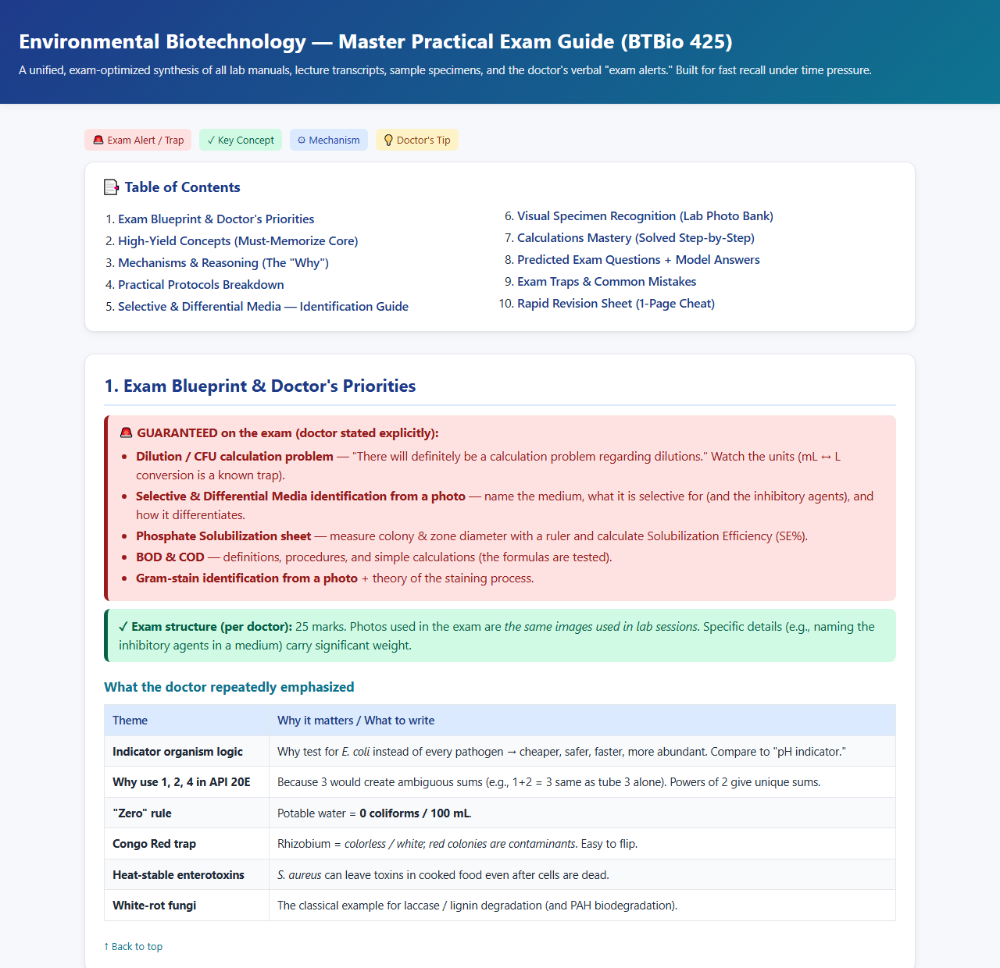
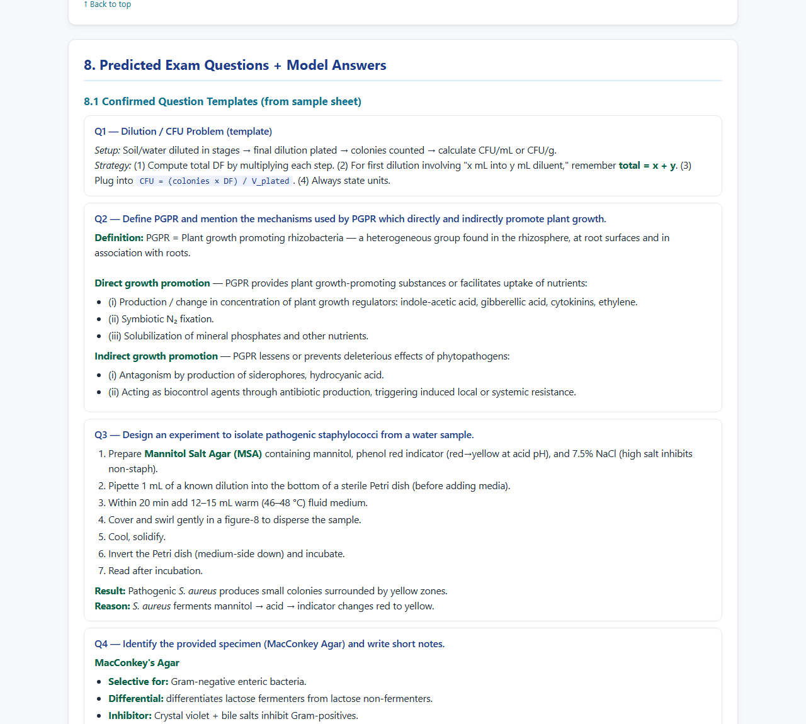
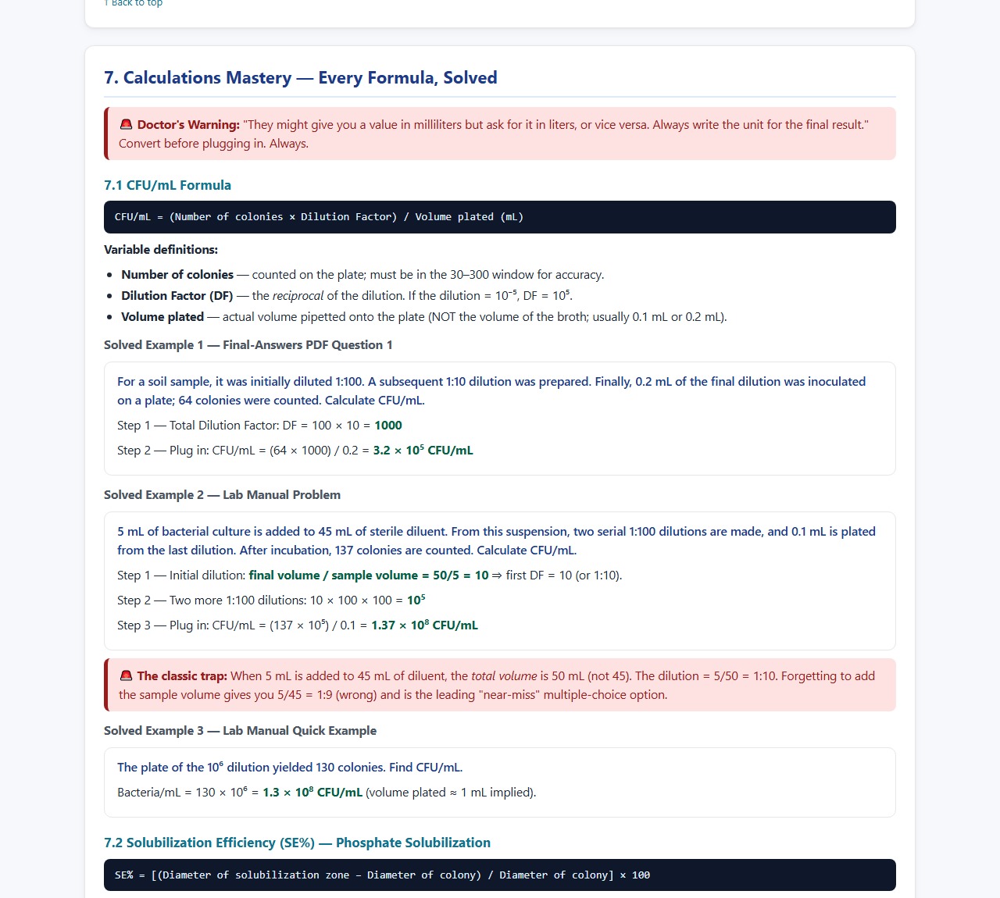
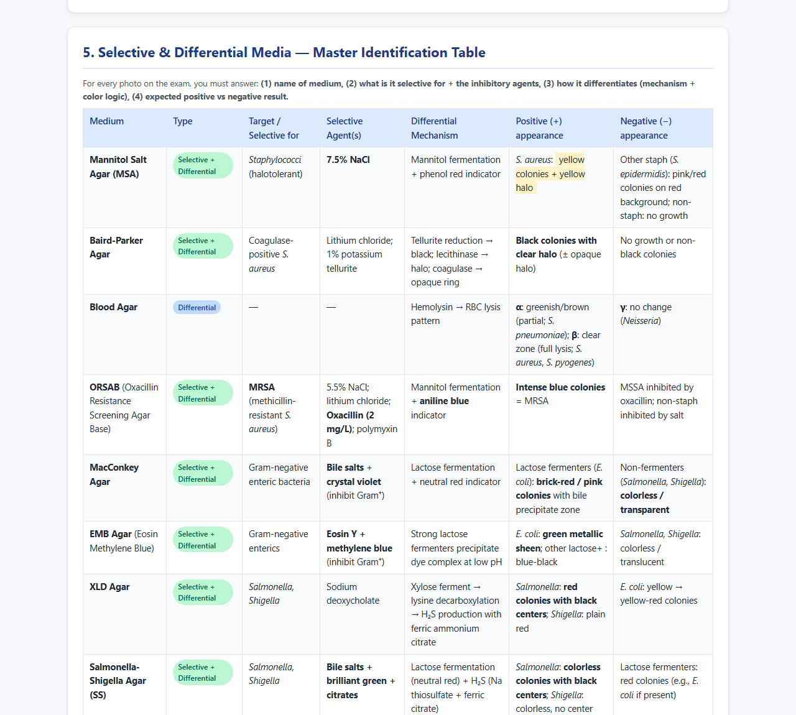
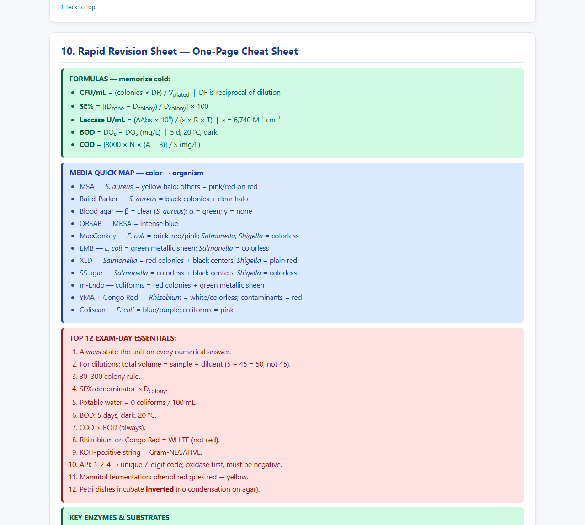

**Upload your lecture slides, past papers, and the doctor's notes. Get back what the exam will most likely ask, how to answer it for full marks, and a study guide built for the night before.**

It's a free, open-source [Claude skill](https://docs.claude.com/en/docs/agents-and-tools/agent-skills/overview) for students: an AI exam predictor and study-guide generator that works only from *your* course material — slides (PDF or PowerPoint), the professor's booklet (المذكرة), lecture transcripts in English or Arabic, past exam papers (even phone photos), model answers, and lab manuals.

[**See a real example →**](examples/environmental-biotechnology/) · [**Install the skill**](https://github.com/SamDozer/exam-study-guide-predictor#install-the-skill) · [**GitHub**](https://github.com/SamDozer/exam-study-guide-predictor)

## A real example

A practical-exam guide for an Environmental Biotechnology course (BTBio 425), made from the lab manuals, lecture transcripts and specimen photos. [Open the full guide](examples/environmental-biotechnology/).

## What it does

- **Predicts the exam** from the evidence: past papers, what the doctor said in lectures (it reads Egyptian Arabic, including messy transcripts and Franco-Arabic group messages), what's bold, underlined or red on the slides, and how much each topic is worth in marks. Every prediction is tagged HIGH, MEDIUM or LOW, with the reason.
- **Keeps facts and guesses apart.** What the doctor actually said is on the exam is quoted word for word; what the skill predicts is clearly marked as a prediction.
- **Teaches you how to answer.** Question-type recognition, model answers written to the marks, the traps, and a time plan for the exam room.
- **Works for Egyptian midterms and finals.** Courses split between several doctors, dropped material (محذوف), and the usual question styles: Give reasons, Write short notes, Compare, ✓/✗ with correction.
- **Optional flashcards.** It can turn the predicted questions into Anki cards, or coach you with spaced repetition until exam day — only if you ask.

Built for biology, biotechnology, biochemistry, microbiology, chemistry and related courses, and it adapts to any subject you give it.

[Get it on GitHub](https://github.com/SamDozer/exam-study-guide-predictor) — free, MIT licensed.
